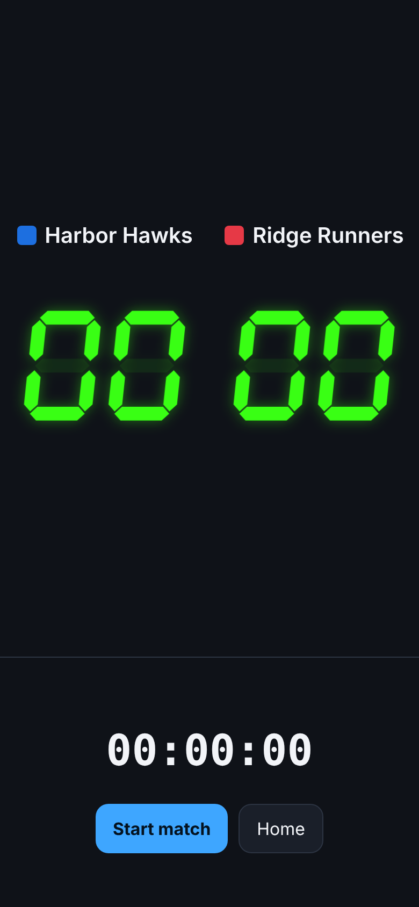
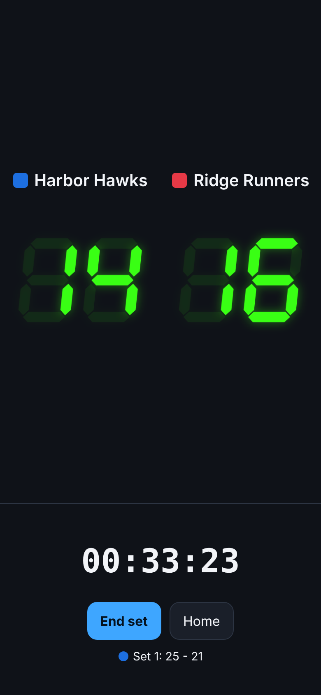
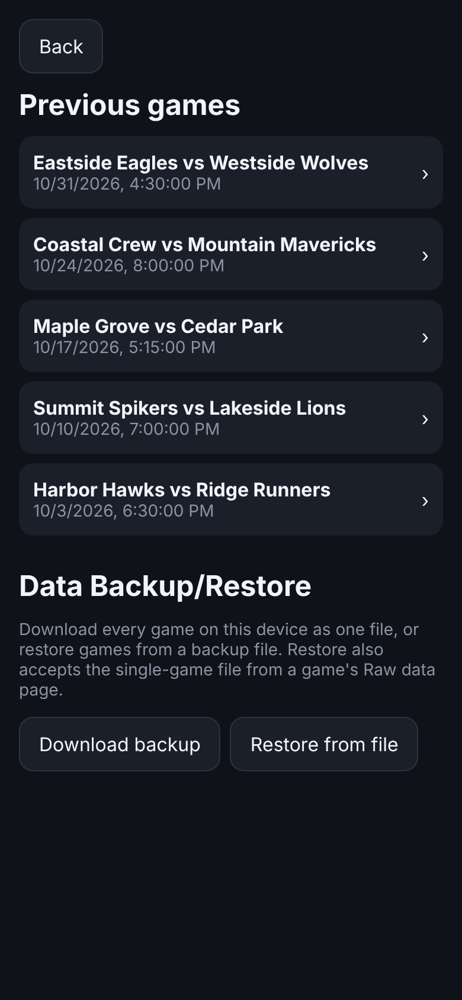
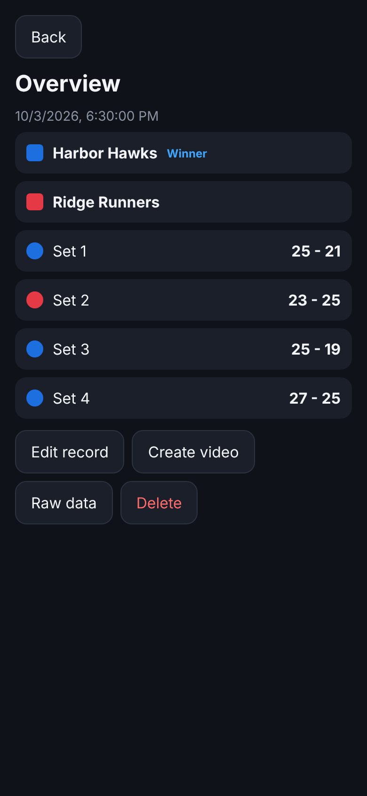
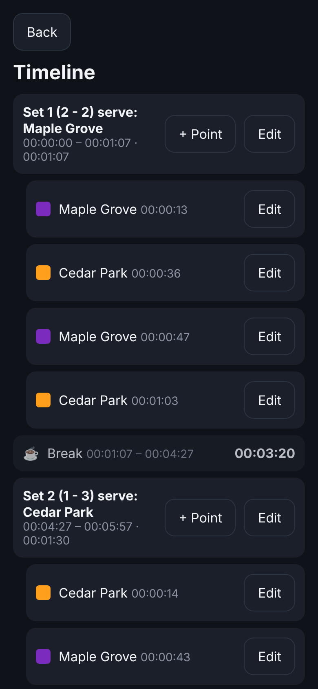
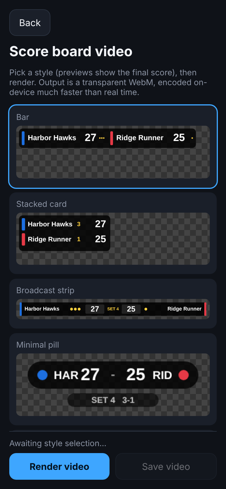
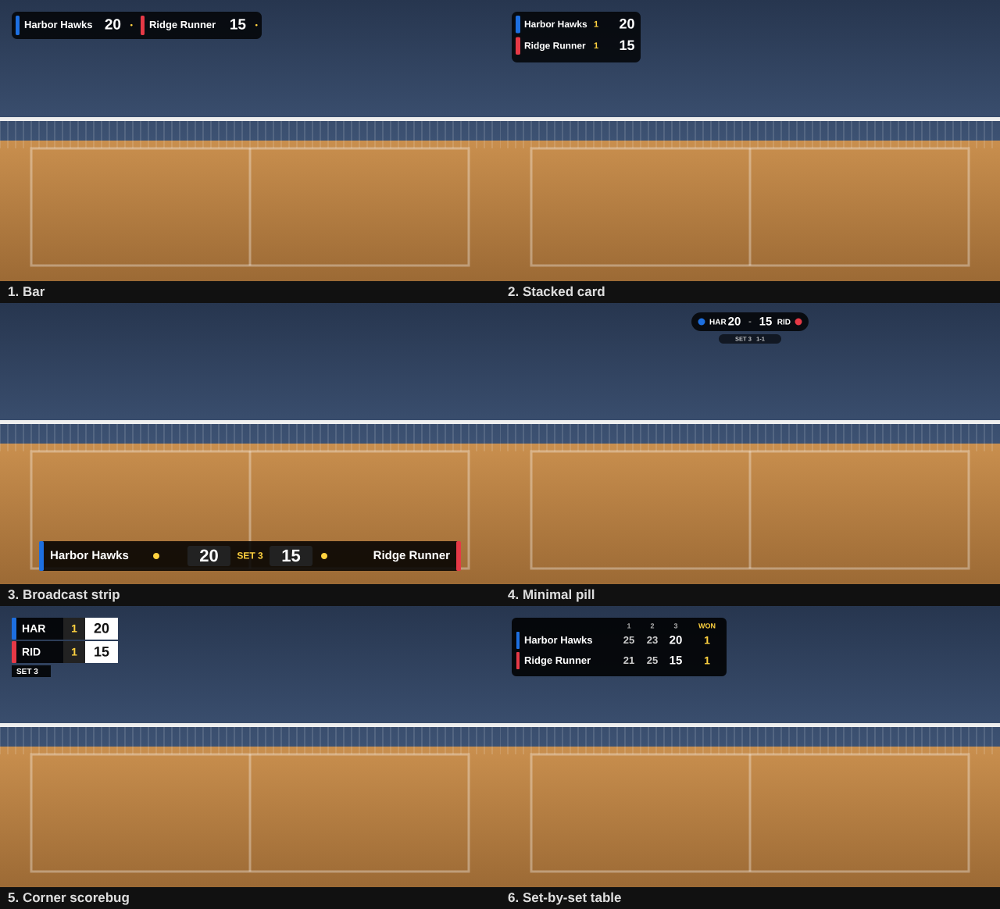

# 🏐 VolleyTrack

**Score a volleyball match on your phone, then turn the play-by-play into a transparent scoreboard video you can drop on top of your game footage.**

VolleyTrack is a single-page web app (plain HTML, CSS and JavaScript, no framework and no account) built for the sideline. It records *when* every point and set happened, keeps all data on your device, works with no internet connection, and exports both the raw event data and a scoreboard overlay video.

> All screenshots in this README use fictional teams and mock data (see [`test-data/mock-games.json`](test-data/mock-games.json)).

<table>
  <tr>
    <td align="center"><br><sub>New match</sub></td>
    <td align="center"><br><sub>Live scoring</sub></td>
    <td align="center"><br><sub>Previous games and backup</sub></td>
  </tr>
  <tr>
    <td align="center"><br><sub>Game overview</sub></td>
    <td align="center"><br><sub>Timeline editor</sub></td>
    <td align="center"><br><sub>Overlay style picker</sub></td>
  </tr>
</table>

---

## Why it is useful

If you film volleyball matches, you probably want a live-looking scoreboard on the footage, but a streaming setup is overkill for most gyms and the venue Wi-Fi is usually bad. Adding a scoreboard by hand in a video editor means scrubbing through the whole match to type in every score change.

VolleyTrack splits the job in two:

1. **During the match**, one person taps the score on a phone. Every point, set start and set end is stamped with the exact time.
2. **After the match**, the app turns those timestamps into a transparent scoreboard video. In your video editor, place it on a layer above the match footage and line up its first frame with the moment you pressed *Start match*. The scores then change when the points happened on the court.

Because the recorded data is just timestamps, it can also be corrected afterwards (an accidental tap, a point you gave to the wrong team) without redoing anything, and it can be exported as JSON for statistics or other tools.

## Features

**Live scoring**
- Tap a team's score to add a point. Swipe down on a score to remove that team's last point.
- Large green 7-segment style digits, team names and color chips (tap a team to edit its name, color, and optional overlay name and 3-letter code).
- Running match timer, serving-team prompt at the start of each set, confirmation before ending a set or the game.
- Finished set results appear under the buttons as the match goes on.
- Keeps the screen awake while a game is being scored (where the browser supports it).

**History and overview**
- List of finished games, newest first, with team names and date.
- Game overview with the score of every set, a color circle for each set winner, and a "Winner" label for the team that won the most sets.

**Record editing**
- Timeline of every set with its start, end, duration and points, with the break between sets shown.
- Add or remove time from a set, swap the serving team, add a set, add a point.
- **Sync points:** shift every point in the game earlier or later by a few seconds, to fix the usual lag between a rally ending and the score being tapped. Points stay inside their own set.
- Edit a point: move it by seconds, reassign it to the other team, or delete it.
- Timeline consistency is protected: sets cannot overlap, points must stay inside their set, and extending a set into the next one asks before shifting every later set.

**Export**
- **Raw data:** the full game record as JSON, to copy or download.
- **Backup / restore:** download every game as one file, and restore from a backup file or a single-game file.
- **Scoreboard video:** six overlay styles, rendered as a transparent WebM entirely on the device (nothing is uploaded anywhere).

**Phone friendly**
- Installable to the home screen and usable offline after the first visit (progressive web app).
- Designed for portrait use. A "please turn your phone upright" cover appears if a phone is turned sideways.

## Overlay styles

The overlay video is 1920×1080 (full HD) with a transparent background. It scales cleanly onto higher-resolution footage such as 4K.



How the video is made: a scoreboard only changes when something happens, so instead of filming the whole match in real time the app encodes one frame at every point, set start and set end (plus a refresh frame every 10 seconds). Every frame carries its true time offset from the start of the match, so a 90-minute game renders in a short time rather than 90 minutes.

## Typical workflow

1. Open the app, tap each team to set names and colors, and press **Start match**. Choose who is serving.
2. Tap the scores as points happen. Press **End set** when a set finishes, then **Start next set** or **End game**.
3. After **End game**, the overview page opens. Fix any mistakes under **Edit record**.
4. Press **Create video**, pick a style, press **Render video**, then **Save video**.
5. In your video editor, put the overlay above the footage and align the overlay's first frame with the moment you pressed *Start match* (many people start the match in the app on a recognizable event, such as the first serve, to make this easy).
6. Use **Raw data** or **Download backup** (Previous games page) to keep a copy of the data.

## The data format

Everything the app stores follows this shape (this is what **Raw data** shows, and what backup files contain):

```json
{
  "id": 1759516200000,
  "version": 2,
  "teams": [
    { "id": "t_k3x9ab", "name": "Harbor Hawks",  "color": "#1d6fe0", "code": "HAR" },
    { "id": "t_p7m2qz", "name": "Ridge Runners", "color": "#e63946" }
  ],
  "start": 1759516200000,
  "end": 1759521060000,
  "sets": [
    {
      "start": 1759516200000,
      "end": 1759517700000,
      "server": "t_k3x9ab",
      "points": [
        { "t": 1759516231000, "team": "t_k3x9ab" },
        { "t": 1759516258000, "team": "t_p7m2qz" }
      ]
    }
  ]
}
```

- All times are **absolute epoch milliseconds**. The app shows them relative to the game or set start.
- Teams have explicit ids. Points and the serving team refer to a team by id, never by position.
- `short` (overlay name, max 12 characters) and `code` (3-letter code) are optional per-team fields. When missing, the overlays use the first 12 characters and the first 3 letters of the name.
- `end` is `null` while a game or set is still in progress.
- A backup file wraps a list of these records: `{ "app": "VolleyTrack", "type": "backup", "version": 2, "exported": "...", "games": [ ... ] }`. Restore accepts either a backup file or a single game record.

## Testing with mock data

[`test-data/mock-games.json`](test-data/mock-games.json) is a backup file containing five fictional finished games (best-of-3 and best-of-5 matches, a set that went past 25 points, and a deciding set to 15). The scores, rally timing and breaks are generated to look like real matches, and the file passes the app's own validation.

To load it, open **Previous games**, scroll to **Data Backup/Restore** and choose **Restore from file**.

Tip: these games are added to whatever is already stored. Load them in a separate browser profile or a test install if you do not want them mixed in with real matches. Each game can be removed with **Delete** on its overview page.

## Installing and hosting

The app is hosted as static files on GitHub Pages and needs no server code.

Files in the repository root: `index.html` (the whole app), `manifest.webmanifest`, `sw.js` (offline cache), `icons/`, and `.github/workflows/pages.yml`.

- The GitHub Actions workflow builds the video library from npm at deploy time and publishes the site, so nothing is loaded from a third-party CDN when the app runs.
- In the repository settings under **Pages**, the source must be set to **GitHub Actions**.
- Open the site address on the phone while online, wait a few seconds, then use **Add to Home Screen** (iPhone: Share menu in Safari) or the browser's install option (Android). After that it launches and runs offline.
- After you change a file and commit, the site rebuilds and the phone picks up the update in the background, typically on the next launch or the one after.

## Things to know

- **Back up your data.** Games live in the browser's local storage on that one device. On iPhone, the system can clear a web app's storage when space is low, and deleting the home-screen icon removes the saved games. The browser and the installed app also keep separate data, so pick one. Use **Download backup** regularly.
- **Video rendering needs a browser with WebCodecs video encoding.** Rendering and saving has been tested in a recent Firefox. Other current desktop and Android browsers should work but are untested, and iPhone Safari is the biggest unknown. If rendering isn't available, the page says so and you can still export the raw data.
- **Transparent WebM support varies between video editors.** If your editor shows a black background, convert the file first, for example with FFmpeg: `ffmpeg -c:v libvpx-vp9 -i scoreboard.webm -c:v prores_ks -profile:v 4444 -pix_fmt yuva444p10le scoreboard.mov`.
- **No automatic volleyball rules.** The app does not enforce 25 points, 15 in the deciding set, or win-by-two. A set's winner is simply the team with more points when you end the set (a tie has no winner).
- **Overlay text is short.** The overlays show each team's overlay name (up to 12 characters) and 3-letter code. Both are filled in automatically from the team name, and you can set your own when editing a team.
- **One game can be in progress at a time.**
- **Portrait lock.** iPhone does not allow web apps to lock the orientation, which is why a "turn your phone upright" cover is shown in landscape. Android honors the portrait setting in an installed app.
- **Keeping the screen awake** uses the browser's Wake Lock feature. As far as I know, iPhone supports it in installed home-screen apps only from iOS 18.4 onward.

## Project layout

```
index.html                 the whole app (HTML, CSS and JavaScript, commented)
manifest.webmanifest       install metadata (name, icons, portrait)
sw.js                      service worker for offline use
icons/                     app icons
.github/workflows/         GitHub Pages build and deploy
test-data/mock-games.json  fictional games for testing (restore into the app)
docs/screenshots/          images used in this README
```

## Credits

Video encoding uses [Mediabunny](https://github.com/Vanilagy/mediabunny), bundled into the site at deploy time.
